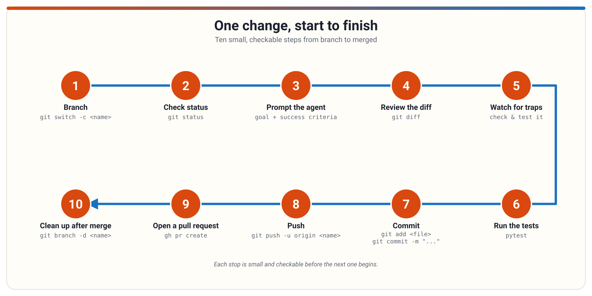

# One change, start to finish

A guided tour of one small code change, from branch to merged, one checkable step at a time.

<!--
**Graphic.** Title slide with a simple hand-drawn path from "idea" to "merged", with small icons at each stop.
**Short note.** Today we walk one small change all the way through ten steps: branch, check status, write the prompt, review, watch for traps, test, commit, push, pull request, cleanup.
**Deep note.** Ask the room: how many of you have edited a file and worried about breaking something? The whole point of this workflow is that every step is small, checkable, and reversible. By the end, one change will feel like a routine, not a leap.
**Lessons.** none
-->

---

## Step 1: Make a branch

- A **branch** is a movable pointer to a commit, not a copy of the project
- Working on a branch keeps your changes off the main line of development
- `git switch -c <name>` creates a branch and moves you onto it

```
git switch -c my-change
```

<!--
**Graphic.** A main line with a small side path branching off, labeled "your change lives here".
**Short note.** A branch is just a named pointer, so creating one is cheap. Do it before you start editing.
**Deep note.** Common mistake: `git branch <name>` creates the pointer but does not switch to it, so new commits land on the old branch. Use `git switch -c` to create and move in one step. Also note: a branch name stays local until you push it.
**Lessons.** git-and-github/branches-and-switching
-->

---

## Step 2: Know where your work lives

- Git has three areas: the **working tree** (files you edit), the **staging area** (what the next commit will record), and the repository (committed history)
- `git status` shows what is untracked, modified, or staged
- `git add <path>` stages chosen files for the next commit

```
git status
```

<!--
**Graphic.** Three boxes in a row: working tree, staging area, repository, with arrows showing files moving left to right.
**Short note.** Editing a file changes only the working tree. Staging chooses what the next commit will include.
**Deep note.** Read `git status` before staging anything. The sections mean different comparisons: "changes to be committed" is the staging area versus the last commit; "not staged" is the working tree versus the staging area; "untracked" means Git is not recording the file yet. Mixing these up leads to committing more or less than you meant.
**Lessons.** git-and-github/working-tree-staging-and-status
-->

---

## Step 3: Tell the agent exactly what you want

- State the outcome you want, not just "make it better"
- Write **success criteria**: short, checkable statements of what "done" means
- Give reasons for rules and limit scope so the agent does not build extra things

<!--
**Graphic.** A side-by-side of a vague prompt ("improve this") versus a direct prompt with a short "done" checklist.
**Short note.** Say the result, define how you will check it, and bound the scope before you ask.
**Deep note.** "Make it good" is not a criterion. If you cannot picture a yes-or-no check, it is not done yet. A good "done" list also protects you from scope creep: if a suggested change is not on the list, you can decline it confidently. Write the criteria before the first prompt, not after seeing the output.
**Lessons.** prompt-engineering/clear-and-direct-instructions, prompt-engineering/defining-goals-and-success-criteria
-->

---

## The whole journey on one page

- Ten small steps from idea to merged change
- Each step is checkable, so mistakes stay small



<!--
**Graphic.** The hand-drawn infographic itself: branch, prompt, review, test, commit, push, pull request, cleanup, drawn as a winding path with numbered stops.
**Short note.** Here is the map. The next slides walk each stop in order.
**Deep note.** Point out that the loop is small on purpose: every step either produces something checkable (a diff, a test result, a review) or moves already-checked work forward. If a step feels scary, it usually means the previous step was skipped.
**Lessons.** git-and-github/branches-and-switching, git-and-github/pull-requests-and-review
-->

---

## Step 4: Review the diff yourself

- A **diff** shows exactly what changed, line by line
- Read the real diff, not the agent's summary of what it did
- Run the checks yourself; plausible prose is not evidence

```
git diff
```

<!--
**Graphic.** A chat bubble saying "all tests pass!" next to a diff view showing an unexpected extra file changed.
**Short note.** The agent's story is the least reliable input. The diff and the test output are the truth.
**Deep note.** Verify against the success criteria you wrote earlier. Check that only expected paths changed, skim for debug junk or secrets, and run the agreed test command yourself. When a check fails, re-prompt with the failure facts and tighter scope rather than accepting the story.
**Lessons.** prompt-engineering/verifying-agent-work, git-and-github/commits-and-history
-->

---

## Step 5: Watch for agent-specific traps

- **Hallucinated APIs**: code can call a plausible-sounding function that does not exist
- **Missed edge cases**: the obvious case works, the corner case does not
- You are accountable for what you merge, no matter who or what wrote it

<!--
**Graphic.** A confident-looking code snippet with a function name circled and a question mark: "does this even exist?"
**Short note.** Agent code reads fluently, but fluency is not correctness. Check names against real files and run the tests.
**Deep note.** Ask the room: how would you catch a call to a function that was never defined? Usually a failed import, type-check, or test run exposes it fast — that's why this workflow pairs a human review of the diff with running the real checks, rather than trusting either alone. Also ask the corner-case question the agent may not have: empty input, unusual format, null value.
**Lessons.** agentic-ai-development/reviewing-agent-generated-code
-->

---

## Step 6: Run the tests locally

- A test runner prints a compact pass/fail summary, then details for failures
- pytest shows a dot per passing test and an `F` per failing test
- The **exit code** is the machine-readable summary: 0 means all passed, 1 means some failed

```
pytest
```

<!--
**Graphic.** A terminal window showing a pytest summary line like "1 failed, 1 passed" with the F highlighted.
**Short note.** Run the tests yourself and read the summary first, then the failure details.
**Deep note.** Watch for exit code 5 in pytest: "no tests collected" means nothing ran, which looks like success but is not. A failing test is usually a real signal about behavior, so verify manually before dismissing it.
**Lessons.** testing-basics/run-tests-locally
-->

---

## Step 7: Commit the change

- A **commit** is a recorded snapshot of the staged content, with author, time, and message
- `git add` stages, then `git commit -m` records; two separate steps
- Write the message summary in the imperative mood: "Add the missing header"

```
git add notes.txt
git commit -m "Add a note about the new line"
```

<!--
**Graphic.** A chain of snapshot icons, each labeled with a short message, linked parent to child.
**Short note.** Nothing is committed unless it was staged first, so add and commit are two steps.
**Deep note.** A commit is a snapshot, not a diff. Check `git diff --staged` before committing to see what the commit will actually record. If you need to fix the most recent commit, `git commit --amend` replaces it, but never amend a commit that has already been pushed or shared.
**Lessons.** git-and-github/commits-and-history
-->

---

## Step 8: Push and set upstream

- `git push` publishes your local commits to a **remote** repository, such as on GitHub
- `git push -u origin <branch>` pushes the branch and records its **upstream** (the default remote branch for later push and pull)
- The first push of a new branch name creates that branch on the remote

```
git push -u origin my-change
```

<!--
**Graphic.** A laptop pushing commits along an arrow to a cloud labeled "remote", with a small tag marking the upstream link.
**Short note.** Push sends your commits to the remote; it does not pull anything down.
**Deep note.** If a push is rejected because the remote branch moved, treat it as a stop sign: fetch, inspect, integrate, then push again. Never answer a rejection with a blind force push, which can delete other people's commits from the branch tip.
**Lessons.** git-and-github/push-and-upstream-branches
-->

---

## Step 9: Open a pull request

- A **pull request** is a GitHub feature for proposing that one branch merge into another, with discussion and review; it is not the `git pull` command
- The **base** branch receives the change; the **head** branch carries your commits
- Reviewers comment, approve, or request changes before anyone merges

```
gh pr create
```

<!--
**Graphic.** Two branches converging, with a speech-bubble conversation and approve/check icons between them.
**Short note.** The pull request is where people look at your change before it lands.
**Deep note.** The central naming trap: `git pull` updates your local branch from a remote; a pull request asks the host to merge head into base after review. Pushing more commits to the same branch updates an open pull request automatically. Drafts share early work but cannot be merged until marked ready.
**Lessons.** git-and-github/pull-requests-and-review
-->

---

## Step 10: Clean up after merge

- After the pull request merges, switch to the default branch and pull the result
- Delete the finished branch locally with `git branch -d` (it refuses unmerged work)
- `git fetch --prune` clears stale remote-tracking names

```
git switch main
git pull
git branch -d my-change
git fetch --prune
```

<!--
**Graphic.** The winding path from the infographic with the last stops highlighted and a small broom icon sweeping away the finished branch.
**Short note.** Merging on the host does not update your laptop; you pull, then retire the branch.
**Deep note.** Prefer `git branch -d` over `-D`: the lowercase form only deletes when Git believes the work is already merged, which is a safety rail. After a squash merge, `-d` may refuse even though the change landed; verify the content is on the default branch before force-deleting. Prune keeps your local view of remote branches honest.
**Lessons.** git-and-github/post-merge-synchronization-and-cleanup
-->
