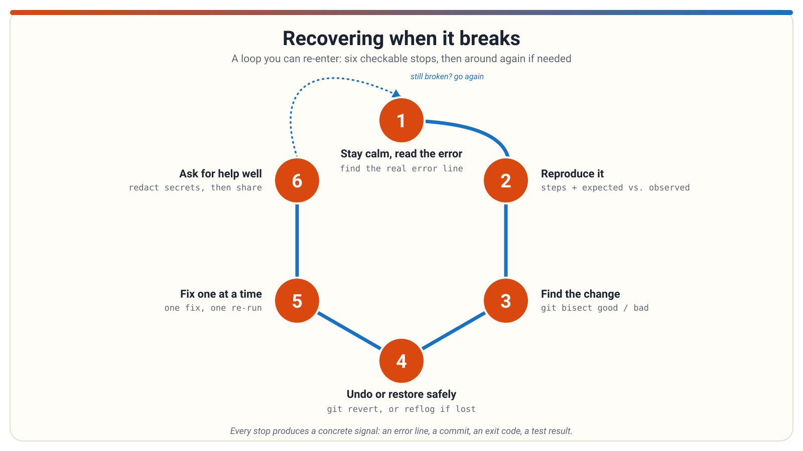

# Recovering when it breaks

Staying calm when something breaks — and working through it in a small, orderly way: read the real error, check the signals, undo carefully, and ask for help well.

<!--
**Graphic.** A calm title slide: a single broken line in a diagram being repaired step by step, with a steady "one step at a time" motif.
**Short note.** Things will break — that's normal. This deck is about staying calm and recovering in small, orderly steps instead of panicking or guessing.
**Deep note.** Beginners often respond to a failure by changing many things at once or by deleting everything. The theme of this deck is that recovery is a sequence of small, checkable steps. Ask the room: what do you usually do first when something breaks?
**Lessons.** none
-->

---

## Stay calm, find the real error

- A **stack trace** (also called a traceback) is the sequence of calls active when the error happened.
- Programs conventionally write errors to **stderr** (standard error), a separate output stream from **stdout** (standard output) — a decades-old convention.
- The core skill: find the **actual error line** (the error type and message) inside a long, intimidating wall of text.
- Then find the **frame nearest your own code**, rather than library internals.

```
Trace text... frame after frame of active calls ...
ErrorType: descriptive message about what went wrong
```

<!--
**Graphic.** A long stack trace with one line highlighted — the error type and message — and an arrow pointing to the frame in "your code" among many framework frames.
**Short note.** Don't be intimidated by a long trace. Scan for the error type and message first, then find the call nearest code you wrote.
**Deep note.** A trace is a snapshot of the path the program took to reach the failure. A long one usually means a deep call chain, not a complex problem — frameworks add many frames that aren't yours. A common mistake is capturing only stdout when saving output, which can silently lose the stderr error. Ask the room: in a 50-line trace, which single line matters most?
**Lessons.** debugging-recovery/read-error-messages
-->

---

## Check the exit code, not just the output

- Every finished command leaves an **exit code** — a number the tool returns to the shell to report how things went.
- By convention: **0 = success**, **non-zero = failure** of some kind.
- A returned prompt proves nothing — the shell shows the prompt whether the command succeeded or failed.
- Visible output proves nothing either — a command can print friendly text and still fail, or succeed while printing nothing.
- The exit code is the tool's own structured statement; this is often how an agent knows a command "failed" even when you saw no error on screen.

<!--
**Graphic.** Two terminal panels side by side: one with chatty output but a non-zero exit code (failed), one silent with exit code 0 (succeeded) — with a "verdict" badge on each.
**Short note.** Success and failure are reported through a channel separate from the visible output. The exit code, not the prompt or the text, is the verdict.
**Deep note.** Beginners treat a returned prompt or polite output as proof of success — neither is. Beyond 0/non-zero, specific values vary by tool, so don't assume a number means the same thing everywhere. Ask the room: if an agent says a command failed but you saw no error, what would you ask it for?
**Lessons.** dev-tooling-literacy/exit-codes
-->

---

## Read the logs for context

- **Logs** are short records an application writes about what it is doing; each line typically has a timestamp, a message, and a **severity level**.
- **DEBUG** — very detailed internal activity, normally hidden in everyday operation.
- **INFO** — routine, expected events: a server started, a request was handled.
- **WARNING** — something unusual happened, but the application kept going.
- **ERROR** — a specific operation failed; this is the signal to act on.
- Not every log line is a failure — judge by severity level, not by volume.

<!--
**Graphic.** A terminal log stream with lines color-coded by level: gray INFO lines, a yellow WARNING, and one red ERROR line circled as "the one that matters."
**Short note.** A wall of log output is mostly routine narration. INFO is expected noise, WARNING is a heads-up, and ERROR is where to focus.
**Deep note.** Beginners panic at the volume of INFO lines, or feel relief when no ERROR lines appear — but a silent app isn't necessarily healthy, and warnings often persist in healthy applications. Ask the room: if a log ends with a successful startup, what does that tell you about the lines above it?
**Lessons.** dev-tooling-literacy/logs-and-severity-levels
-->

---

## Reproduce it on demand

- **Reproducing a bug** means establishing repeatable starting conditions, inputs, and actions that reliably make the symptom appear.
- Write down three things: **starting conditions** (branch, server state, configuration), the **exact steps in order**, and **expected vs. observed** behavior.
- A symptom the agent can reproduce, it can investigate; a symptom it cannot reproduce, it can only guess at.
- Try the steps again before reporting — if the symptom doesn't recur, say so honestly; that's useful information too.

<!--
**Graphic.** A written "bug recipe" card with three labeled sections: Starting conditions, Steps (numbered), Expected vs. Observed — with a repeat counter like "3 out of 3 tries."
**Short note.** Turn a one-time impression into a repeatable recipe. Numbered steps in order, plus what you expected versus what you saw.
**Deep note.** "It's broken" gives an agent nothing to re-run. Note what varies between attempts — a fresh restart versus a long-running server often explains "works the first time, fails after." Ask the room: what prior action might your bug secretly depend on, like a login or a first save?
**Lessons.** dev-tooling-literacy/reproducing-a-bug
-->

---

## The whole recovery path on one page

- Recovery is a **loop you can walk back through** when something breaks — not a single leap to a fix.
- Each stop is **checkable**: read the real error, confirm the exit code, scan the logs for the ERROR line.
- Make the symptom **repeatable**, then narrow down **which change** broke it.
- Undo with the **right tool**, fix **one failure at a time**, and **escalate well** if you're stuck.



<!--
**Graphic.** The provided infographic: a loop-shaped recovery map from "stay calm" through reading errors, exit codes, logs, reproduction, bisecting, undo tools, stash, conflict resolution, one-fix-at-a-time, and asking for help.
**Short note.** This map is the deck in one picture. When something breaks, find where you are on the loop and take the next small checkable step.
**Deep note.** The value of the map is that no step requires guessing — every stop produces a concrete signal (an error line, an exit code, a log level, a commit). Ask the room: which stop on this loop do you skip most often, and what does skipping it cost you?
**Lessons.** debugging-recovery/read-error-messages, dev-tooling-literacy/exit-codes, debugging-recovery/bisect-and-blame
-->

---

## Find which change broke it

- `git bisect` performs a **binary search** across your commit history to find the exact commit where a problem was introduced.
- Mark one commit **bad** (shows the bug) and one **good** (does not); git checks out midpoint commits for you to test.
- Each `good`/`bad` report halves the remaining suspects, so even long histories converge in a handful of rounds.
- `git bisect reset` returns you to your original branch when done — always run it, or you stay on a detached checkout.

```bash
git bisect start
git bisect bad                 # current version is bad
git bisect good <commit>       # last known good revision

# git then checks out a midpoint commit; you test it and report:
git bisect good                # or
git bisect bad

# When finished:
git bisect reset
```

<!--
**Graphic.** A row of commits with a shrinking highlighted range: after each good/bad report, the range halves, ending at one circled "first bad commit."
**Short note.** Tell git one bad commit and one good commit, test the midpoints it checks out, and the search narrows fast. Finish with git bisect reset to get back to your branch.
**Deep note.** A wrong "good" mark poisons the whole search — verify your endpoints. Bisect finds the culprit; deciding the fix is a separate step. Ask the room: roughly how many test rounds does a 1,000-commit range take with halving?
**Lessons.** debugging-recovery/bisect-and-blame
-->

---

## Choose the right undo tool

- **`git revert`** makes a **new** commit that undoes an earlier one and keeps history intact — the safe choice once something is shared or pushed.
- **`git reset`** moves the current branch tip; depending on mode (`--soft`, `--mixed`, `--hard`) it may also change the **index** (the staging area) and the working tree — a **local-only** tool.
- **`git restore <path>`** discards uncommitted edits in the working tree; `git restore --staged <path>` safely unstages without discarding.
- Plain rule: **committed work is almost always recoverable**; uncommitted edits discarded by `git reset --hard` or `git restore` are **not**.

<!--
**Graphic.** A decision tree: "Already pushed or shared?" → revert; "Local tip adjustment?" → reset (with soft/mixed/hard branches); "Just one file's edits?" → restore, with a warning sign on the destructive paths.
**Short note.** Pick the undo tool by what you're undoing and whether anyone else has the commits. Shared history gets revert; local cleanup gets reset or restore.
**Deep note.** The honest boundary: Git can usually recover committed work, but bytes that were never committed and got discarded are gone — commit early and often. Ask the room: which of these three tools would you use on a branch a teammate already pulled?
**Lessons.** git-and-github/undoing-and-recovering-work
-->

---

## Recover a lost commit with the reflog

- **`git reflog`** is a local log of where `HEAD` and branch tips recently pointed.
- **`ORIG_HEAD`** names the tip as it was immediately before the last reset.
- `git reset --hard ORIG_HEAD` (or to a chosen `HEAD@{n}` entry) can put the branch tip back.
- Inspect with `git reflog` and `git log` first — and recover sooner rather than later, since reflog entries are eventually pruned.

```bash
$ git reset --hard HEAD~2
$ git reflog
# find the entry from before the reset (often HEAD@{1} or ORIG_HEAD)
$ git reset --hard ORIG_HEAD
# or: git branch recover-tip HEAD@{1}
```

<!--
**Graphic.** A reflog listing with entries HEAD@{0}, HEAD@{1}, ... and an arrow from "ORIG_HEAD" back to the pre-reset tip, showing the branch pointer being restored.
**Short note.** After a scary reset, the commits usually still exist. The reflog tells you their names, and ORIG_HEAD points at where the branch was just before the reset.
**Deep note.** A tip that seems to have vanished after a reset can usually be found again while its reflog entries remain. "I reset too far" is usually fixable when the work was committed — that's exactly what the reflog is for. The mistake to avoid is running another --hard before inspecting, which discards any uncommitted work present at recovery time. Ask the room: why does committing regularly make recovery possible at all?
**Lessons.** git-and-github/undoing-and-recovering-work
-->

---

## Shelve work in progress, don't lose it

- **`git stash`** temporarily saves your uncommitted changes and returns the working tree to a clean state.
- Stashes live on a local **stack** you can `pop` (re-apply and remove) or `apply` (re-apply and keep) later.
- Use it when you need a clean working tree **without committing half-finished work** — for example, to test whether a bug exists in a clean copy of the code.
- Stashing is entirely local; nothing is sent to any remote.

```bash
git stash push -m "message"   # save current changes with a descriptive label
git stash list                # show all stashed entries
git stash pop                 # re-apply the most recent stash and remove it from the list
```

<!--
**Graphic.** A shelf metaphor: half-finished edits being lifted off a messy desk onto a labeled shelf slot, leaving a clean desk, then taken back down later.
**Short note.** Stash is a shelf, not a commit. Push changes onto it, list what's there, and pop them back when you're ready.
**Deep note.** Stash entries are easy to forget — run git stash list regularly, because unclaimed stashes are a common source of "where did my work go?" confusion. Also note stash is not a substitute for committing and pushing important work. Ask the room: when would you prefer apply over pop?
**Lessons.** git-and-github/git-stash
-->

---

## Resolve a merge conflict calmly

- A conflict means **both sides changed the same region** of a file since they diverged, and Git won't guess which to keep — this is **normal**, not a broken repository.
- **Conflict markers** show both sides: `<<<<<<<`, `=======`, `>>>>>>>`.
- Edit the file to the intended result, **remove the markers**, then `git add` the path.
- Finish with `git commit` or `git merge --continue`.
- `git merge --abort` is the safe way out if you want to stop entirely.

<!--
**Graphic.** A file open in an editor showing the three conflict markers with "ours" and "theirs" blocks labeled, and an arrow to the same file after editing: one coherent result, markers gone.
**Short note.** A conflict is a decision point, not an error. Read both sides, write the intended result, remove the markers, stage the file, and finish the merge.
**Deep note.** The common mistake is deleting the markers without deciding what the content should be — that stages cleanly but can be logically wrong. And don't delete the repository or force-reset just because markers appeared. Ask the room: what does the block after ======= represent?
**Lessons.** git-and-github/merge-conflicts
-->

---

## Fix one failure at a time

- When several tests fail, **fix and re-run one failure at a time** — don't change many things and re-run the whole suite once.
- The payoff is **attribution**: after each cycle, you know exactly which change fixed which failure.
- The loop: pick one failing test, make the smallest change you believe fixes it, re-run, confirm it passes and nothing else newly broke, repeat.
- If a "fix" for one test breaks another, that itself is diagnostic information.

<!--
**Graphic.** A cycle diagram: pick one failure → smallest fix → re-run → confirm, with a tally showing each fix linked to the failure it solved.
**Short note.** One fix, one re-run, repeat. That way every change stays connected to the failure it fixed.
**Deep note.** Batch fixing leaves you unable to tell which change mattered — or which one broke something else. This is the same "change one variable at a time" discipline used across engineering, and it matters doubly when an agent is editing on your behalf. Ask the room: what do you lose if you fix three tests in one edit?
**Lessons.** testing-basics/fix-one-failure
-->

---

## Ask for help well

- A good escalation answers three questions: **what happened** (the actual error, not a paraphrase), **what you already tried**, and **what you expected**.
- Quote the real error line — small details like a hostname, exit code, or line number often carry the diagnosis.
- **Redact credentials, tokens, and secrets** from logs before sharing them anywhere — including into an AI agent's context.
- Redact **before** sharing: once text leaves your control it may be copied, forwarded, or retained, and you generally cannot un-share it later.

<!--
**Graphic.** A side-by-side comparison: a weak escalation ("it's broken") versus a structured one with error excerpt, tried list, expected behavior, and a [REDACTED] placeholder where a token was.
**Short note.** Hand over your diagnostic work: the real error, what you tried, what you expected — with secrets replaced by placeholders before anything leaves your machine.
**Deep note.** The most common leak is pasting a raw log first and thinking about redaction later — private channels don't change the standard, since logs can be forwarded or retained. But don't sanitize so hard the report is useless; keep the diagnostic signal. Ask the room: which of the three questions do escalations most often leave out?
**Lessons.** debugging-recovery/ask-for-help
-->