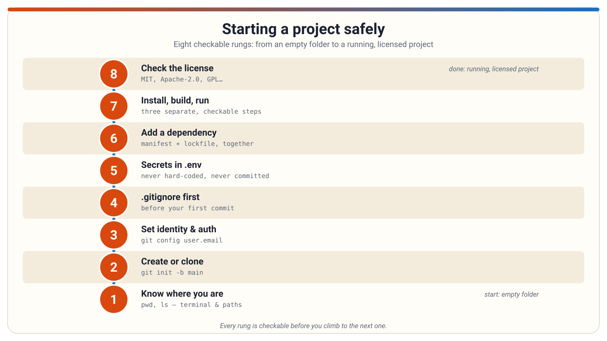

# Starting a project safely

A short guide for non-programmers working with an AI coding agent: how to set up a project so it runs, stays organized, and keeps its secrets safe.

<!--
**Graphic.** A friendly title illustration: a laptop showing a terminal window, with a small robot assistant beside it and a checklist floating between them.
**Short note.** Welcome. This deck is about the setup steps that come before any real coding, and how to review an AI agent's work at each step.
**Deep note.** Most beginners think coding starts with writing code. In practice, a project's safety and success depend on the unglamorous setup: knowing where you are, tracking your files, and keeping secrets out. Ask the room: how many of you have let an AI tool "just do it" without knowing what it was doing? That's the habit we're changing.
**Lessons.** none
-->

---

## Know your layers: terminal, shell, command

- The **terminal** is the window where text appears.
- The **shell** is the program inside it that reads what you type and runs it.
- The **command** is the program the shell starts, plus its **options** and **arguments**.
- A command's shape: `program-name --option value target`.
- You don't need to write scripts — just learn to read: "that's the program, those are options, that's the target."
- If you can't identify the program and the target, ask the agent what the command does before approving it.

<!--
**Graphic.** Three nested boxes labeled Terminal (outer window), Shell (interpreter inside), and Program (what actually runs), with a sample command annotated underneath.
**Short note.** When the agent runs something, it's asking a shell to start a program. Reading the parts of a command is the whole skill here.
**Deep note.** A common mistake is treating the terminal window as "the shell" — but knowing which layer complained helps you ask good questions. "Command not found" is the shell; a crash is usually the program. Also, options are not universal: the same flag can mean different things to different programs. Ask the room: in `npm install --save-dev some-package`, which word is the program?
**Lessons.** dev-tooling-literacy/terminal-shell-commands
-->

---

## Where am I? Working directories and paths

- Every command runs from a folder — the **current working directory**.
- An **absolute path** is a full address from the root of the file system.
- A **relative path** is an address from wherever the command is standing.
- The same relative path can point to different files from different folders.
- "File not found" usually means "not found **from here**" — not that the file is gone.
- First question when an agent loses a file: **what directory was it working from?**

<!--
**Graphic.** A simple folder tree with a stick figure standing in one folder; arrows showing a relative path from there versus an absolute path from the root.
**Short note.** Paths are addresses. Absolute addresses work from anywhere; relative ones depend on where the command is standing.
**Deep note.** This explains a huge share of confusing agent moments: the agent says a file "doesn't exist," or writes a file somewhere unexpected. It was standing in the wrong folder. Also watch for agents resetting to a default directory mid-task, and for absolute paths in shared projects — they may not exist on another machine. Ask: if the agent proposes writing to a path, what should you check first? (Whether it's inside your project folder.)
**Lessons.** dev-tooling-literacy/working-directories-and-paths
-->

---

## Create a repository, or clone one

- A **repository** is a project folder plus a hidden store (`.git`) that records every saved change as a **commit**.
- `git init` creates a new repository in the current folder — it commits nothing by itself.
- `git clone` makes a full local copy of an existing repository, including its history.
- A **remote** is a named link to a copy of the project on a host; after a clone, the default remote name is `origin`.
- A **fork** is a separate host-side copy of a repository — cloning is not forking.

```
git init -b main
git remote add origin <url>
git push -u origin main
```

<!--
**Graphic.** Two paths drawn side by side: "local first" (folder → git init → add remote → push) and "host first" (create on host → clone down), both ending at the same picture of a local repo connected to a remote.
**Short note.** Two ways to start: create the repository locally and push it up, or create it on the host and clone it down. Both end in the same place.
**Deep note.** The most common beginner surprise: after `git init`, nothing has been saved yet — files stay untracked until they are added and committed. Also, if the host repository was created with a README, a first push can fail because the histories diverge; prefer an empty remote for the first push. Ask: why does `git init` alone not put anything online? (It never talks to the network.)
**Lessons.** git-and-github/creating-and-cloning-repositories
-->

---

## Tell Git who you are, and prove it to the host

- **Identity**: `user.name` and `user.email` are the name and email stamped on every commit you make.
- **Authentication** is separate: it's how a host accepts or rejects your connection when you push or clone.
- On GitHub, **HTTPS** uses a **personal access token** (not your account password); a **credential helper** can remember it.
- Over **SSH**, a private key stays on your machine and only the public key is registered with the host.
- Never commit credentials, tokens, or private keys — once committed, they are part of history.

```
git config --global user.name "<name>"
git config --global user.email "<email>"
```

<!--
**Graphic.** Two separate doors: one labeled "Identity" (a name tag on a commit) and one labeled "Authentication" (a key/token at a host's gate), with a note that they are different jobs.
**Short note.** Identity is whose name goes on commits; authentication is whether the host lets you in. Set identity once, globally.
**Deep note.** Config comes in layers too — system, global, and local — with the most specific winning; this exercise sets identity at local scope so it never leaks into other repos. A classic failure: the HTTPS password prompt is not your account password — hosts that require tokens will reject it. And tokens are as sensitive as passwords: scope them narrowly, let them expire, and never paste them into chat or screenshots. If a secret ever gets committed, treat it as compromised and rotate it first — deleting the file later does not un-leak it. Ask: why are these two jobs separate? (One is local labeling; the other is network trust.)
**Lessons.** git-and-github/setup-configuration-and-authentication
-->

---

## Write .gitignore before your first commit

- **`.gitignore`** is a file listing patterns for files Git should leave alone — build output, logs, local settings.
- Each line is a pattern; `#` starts a comment; `!` re-includes a file a previous pattern excluded.
- Ignore rules apply **only to untracked files** — they do not untrack files already committed.
- To stop tracking an already-tracked file: add the pattern, then `git rm --cached <file>` (keeps the file on disk), then commit.
- `git check-ignore <path>` tests whether a rule actually catches a path.
- A `.gitignore` rule does not remove a secret that was already pushed — rotate it.

```
git rm --cached <file>
git check-ignore <path>
```

<!--
**Graphic.** A bouncer at a club door labeled "commit": files with a .gitignore badge walk in, a file marked "secrets.log" is turned away — with a footnote that files already inside stay inside.
**Short note.** Write the ignore file before the first commit, so noise and secrets never enter history in the first place.
**Deep note.** The number-one confusion: "my ignore rule doesn't work!" The file is almost always already tracked — the rule only prevents future tracking. Untrack it deliberately with `git rm --cached`, then the rule takes effect. Also warn against over-broad patterns like a bare `*.dat` that accidentally exclude wanted files; test with `git check-ignore`. Ask: why can't ignoring hide a file from past commits? (History is already written.)
**Lessons.** git-and-github/gitignore-essentials
-->

---

## Configuration lives in environment variables

- **Environment variables** are named settings that programs read from their surroundings — outside the source files.
- Names are conventionally ALL-CAPS, like `PORT` or `DATABASE_URL`.
- Setting one is a shell action, not a code edit; a running program usually needs restarting to pick up a change.
- A variable set in one terminal does not exist in another — a classic "works here, not there" symptom.
- A prefixed command like `PORT=4000 npm run dev` (macOS/Linux shell syntax) supplies a variable to that one command only; PowerShell's syntax for the same idea is different.

```bash
PORT=4000 npm run dev
```

<!--
**Graphic.** The same app box drawn twice, fed by two different dials labeled PORT=3000 and PORT=4000 — identical code, different behavior, because the environment differs.
**Short note.** Environment variables let the same files behave differently in different places — nothing in the code changed; the surroundings did.
**Deep note.** This is one of the first things to consider when a project "mysteriously" differs between two terminals, machines, or deployments. A common mistake: the agent says "I set the variable," but the already-running program holds the old values until restarted — so the fix appears not to work. Also, variables can point the project somewhere unexpected (like a different database), worth confirming before approving consequential actions. Ask: why does a new terminal not see the variable?
**Lessons.** dev-tooling-literacy/environment-variables
-->

---

## Keep secrets in a .env file, never in code

- A **`.env`** file is a plain text file of `NAME=value` pairs that tools load as environment variables.
- **Hard-coding** a secret into source code means the credential travels with every copy, commit, and demo.
- A `.env` file is a convention, not a standard — and it is **not** a secure vault; it's unencrypted text on disk.
- Projects pair the private `.env` with a committed **`.env.example`** template with placeholder values.
- Never paste real credentials into chat, email, or screenshots — put the value in the file yourself.

```text
# .env
WEATHER_API_KEY=replace-me-not-a-real-key
```

<!--
**Graphic.** Side-by-side comparison: a code file with a key pasted inside (marked with a warning) versus a .env file beside the code holding the key, with the code reading it by name.
**Short note.** The shape of good practice: move the secret out of the code and into configuration the program reads at runtime.
**Deep note.** Both versions run identically — the difference appears when the code is shared or committed. A common mistake is assuming ".env" means secure: it only keeps secrets out of source control, not away from anyone who can read the disk. Another trap: copying `.env.example` as your real `.env` and forgetting to replace the placeholders, so the app "runs but does nothing useful." Ask: what should you do if an agent asks you to paste an API key into a source file? (Question it.)
**Lessons.** dev-tooling-literacy/dotenv-and-secrets
-->

---

## Push protection: the backstop when a secret slips

- **Secret scanning** detects known-format secrets (tokens, passwords, keys) that were committed to a repository.
- **Push protection** goes a step earlier: it blocks a push containing a detected secret before it reaches the host.
- When blocked, you can remove the secret and push again — or **bypass** with a stated reason, which generates an alert for review.
- These features can be enabled at the repository, organization, or personal-account level.
- Deleting a secret in a later commit does not remove it — it stays in git history; **rotation** is the reliable fix.

<!--
**Graphic.** A checkpoint gate between your laptop and the host server: a push carrying a secret is stopped at the gate; a clean push passes through.
**Short note.** Push protection is your safety net: even if a secret almost gets committed, the host can block it before it lands.
**Deep note.** Two cautions. First, a bypass is not a silent loophole — the reason is recorded and an alert is created, so don't bypass casually to "get unblocked." Second, don't rely on the backstop alone: a very large push with many already-alerted secrets may not be blocked, and a bypassed push means the secret is on the host and should be treated as exposed until verified. Ask: if a push gets blocked, what are your two options, and which is safer?
**Lessons.** git-and-github/secret-scanning-push-protection
-->

---

## The whole checklist, start to finish

- Safety steps come first: repository, identity, `.gitignore`, then secrets.
- Only after that: dependencies, install, build, run, and the license.
- Each rung is **checkable** before you move to the next one.



<!--
**Graphic.** The provided infographic itself: a step-by-step path from an empty folder through repository setup, ignore rules, secrets hygiene, dependencies, and finally a running, licensed project.
**Short note.** Here is the entire path on one page — an empty folder becomes a tracked, configured, secret-safe, running project.
**Deep note.** Pause here and let the room absorb the sequence. Notice how the early steps (repository, .gitignore, secrets) come **before** any dependencies or running code — setup order matters, because a secret committed in step three is far harder to fix than one prevented in step two. Ask: which step do you think people skip most often, and what does that cost later?
**Lessons.** git-and-github/creating-and-cloning-repositories, git-and-github/gitignore-essentials, dev-tooling-literacy/dotenv-and-secrets, dev-tooling-literacy/install-build-run
-->

---

## Dependencies: someone else's code

- A **dependency** is third-party software your project uses but did not write — a library for dates, databases, or styling.
- A **package manager** finds, downloads, and organizes dependencies — npm for JavaScript, pip for Python.
- Packages come from a public **registry** — a shared online collection; the registry does not vouch for any package.
- Installing a package is adding external software, with its own authors, versions, and licenses — not "enabling a feature."
- A project may not run at all until its dependencies are installed — a normal first-run experience.

```
npm install date-fns
```

<!--
**Graphic.** A shopping cart metaphor: your project's cart receiving labeled packages from a large public marketplace shelf, each package with its own author tag.
**Short note.** When the agent "installs a package," it's fetching real external software and wiring it into your project — routine, but a real change.
**Deep note.** The wrong mental model is "enabling a feature" of a language; packages are outside code with their own update cadence and license terms. A real failure mode is a mistyped or ambiguous package name — a quick sanity check of the name against its registry page is reasonable due diligence. Ask: when an agent adds several packages at once, what should you ask about each one? (Which package, and why.)
**Lessons.** dev-tooling-literacy/dependencies-and-package-managers
-->

---

## Manifest vs. lockfile: the list and the receipt

- A **manifest** (like `package.json`) records what the project **asks for** — often with flexible version ranges like `^4.2.1` ("compatible with 4.2.1").
- A **lockfile** (like `package-lock.json`) records what was **actually installed** — exact versions for the whole dependency tree.
- Mental model: the manifest is the shopping list; the lockfile is the receipt.
- One install legitimately changes **both** files — that's the system working, not the agent being sloppy.
- Commit both files; if either is missing, collaborators may install different exact versions.
- Don't edit a lockfile by hand — the package manager maintains it.

<!--
**Graphic.** Two documents side by side: a handwritten shopping list ("flour") next to a printed receipt ("this exact brand and bag size"), connected by an arrow.
**Short note.** The manifest states intent; the lockfile records resolution. Seeing both change together during an install is a good sign.
**Deep note.** This distinction explains why an agent touches more than one file when adding a dependency — and gives you a review habit: check that both changed together, and ask the agent to explain the manifest change in plain language. A common mistake is assuming the manifest's version range is what got installed; the lockfile is the authoritative record. Also, a regenerated lockfile does not mean the app was tested. Ask: what breaks if a teammate commits the manifest but not the lockfile?
**Lessons.** dev-tooling-literacy/manifests-vs-lockfiles
-->

---

## Virtual environments: one room per project

- A **virtual environment** is a project-specific, isolated space for dependencies — instead of installing onto the whole machine.
- Two projects can use different versions of the same package without conflicting.
- **Activating** an environment points the terminal at that room, so installs land in the right place.
- "Module not found" after a successful-looking install often means the package went into a different (or no) environment.
- An agent creating or activating an environment is doing deliberate, conventional setup — not padding the task.
- The environment folder itself is excluded from version control; the dependency **list** is shared, and the environment is rebuilt.

<!--
**Graphic.** Two separate rooms side by side, each holding its own stack of package boxes labeled with different version numbers, with a door labeled "activate" leading into one room.
**Short note.** Isolation keeps projects from interfering with each other and with the machine. Activation is what makes installs land in the right room.
**Deep note.** The most common symptom of an environment mismatch: the install succeeds but the project still can't find the package — it went somewhere the project doesn't look. Activation is per-terminal, per-session, so a new terminal may mean the environment is no longer active — a frequent source of "it worked yesterday" confusion. And don't confuse isolation with safety: a venv limits interference, not what an agent can do, so it's not a reason to auto-approve actions. Ask: why not just install everything globally?
**Lessons.** dev-tooling-literacy/virtual-environments
-->

---

## Install, build, run — and read the license

- **Install**, **build**, and **run** are three separate steps, each able to succeed or fail on its own.
- A successful build means artifacts were generated — it is **not** proof the app is running.
- "The app is running" is only confirmed by actually reaching the address it reports (like a localhost URL on a port).
- A **license file** (`LICENSE`, `COPYING`, `NOTICE`) states the conditions for using someone else's code.
- **Permissive** licenses (MIT, Apache-2.0) typically require keeping attribution; **copyleft** licenses (GPL family) can impose sharing obligations.
- "Easy to install" is not "free of conditions" — and an agent installing code does not remove your obligation to check.

<!--
**Graphic.** A three-stage assembly line (Install → Build → Run) with a "running?" checkpoint light at the end, plus a small license tag attached to every incoming package box.
**Short note.** Ask which step the agent is describing before drawing conclusions — and remember every dependency arrives with a license attached.
**Deep note.** The most common misread is assuming build success means a working app; a clean build with nothing running produces nothing you can open. Verify the run claim by actually visiting the reported address. On licensing: approving an install is not a license review, and obligations travel through the whole dependency tree — code copied from tutorials or AI suggestions can carry licenses too. Ask: if the agent says "installed and built," what question should you ask next? (Is it running, and where?)
**Lessons.** dev-tooling-literacy/install-build-run, dev-tooling-literacy/license-files
-->